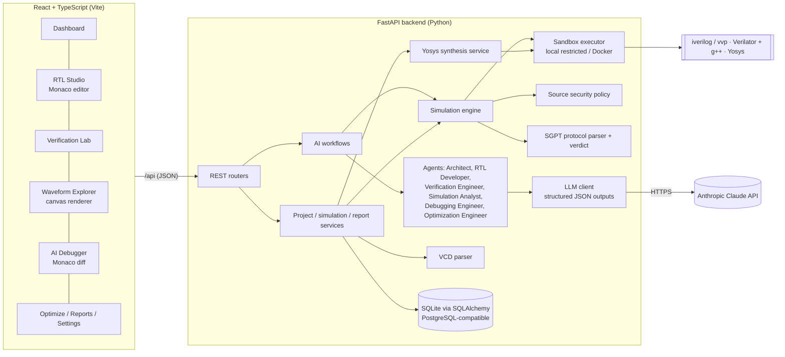

# SiliconGPT — Engineering Architecture

SiliconGPT is an AI copilot for digital hardware engineers. Its core principle: **the AI proposes,
real EDA tools decide.** Every verdict shown in the product (compile status, PASS/FAIL, coverage,
waveforms, synthesis statistics) is produced by Icarus Verilog, Verilator or Yosys running on the
user's actual files. Claude is used to understand specifications, write RTL and testbenches, read
real logs and waveforms, and propose patches — which are then re-validated by simulation.

## 1. System overview



ASCII view of the main verification loop:

```
 spec ─► Architect ─► RTL Developer ─► compile_design (iverilog) ─┐   (repair loop fed with the
                                       ▲                          │    REAL compiler log, ≤2 iters)
                                       └──── repair_rtl ◄─────────┘
 RTL ─► Verification Engineer ─► testbench ─► compile ─► run_simulation ─► [SGPT] records ─► verdict
                                                              │                    │
                                                              ▼                    ▼
                                                         waves.vcd           SimulationRun (DB)
 failed run ─► Debugging Engineer (logs + FAIL records + VCD samples at failure times + RTL)
            ─► patch ─► pre-validation simulation on patched snapshot ─► user applies ─► re-run
```

## 2. Backend modules

| Layer | Module | Responsibility |
|---|---|---|
| Config | `core/config.py` | Environment-driven settings (`backend/.env`); secrets stay server-side |
| Toolchain | `core/toolchain.py` | Probes real binaries (versions, availability, C++ compiler for Verilator) |
| Sandbox | `simulation/sandbox.py` | Executes tools with limits (see §4) |
| Policy | `simulation/policy.py` | Static scan of HDL sources before anything executes |
| Engine | `simulation/engine.py` | Validate → policy → compile → run → parse → verdict; waveform injection |
| Protocol | `verification/protocol.py` | `[SGPT]` self-checking protocol parser and conservative verdict |
| RTL parsing | `services/rtl_parser.py` | Modules, ports, params, instances, top/TB detection, clocks/resets |
| Lint | `services/lint_service.py` | Verilator `--lint-only -Wall` + Icarus `-t null`, parsed diagnostics |
| Formatter | `services/formatter.py` | Conservative, token-preserving re-indentation |
| Waveforms | `waveform/vcd_parser.py` | IEEE-1364 VCD parsing, windows, value-at-time sampling |
| Synthesis | `synthesis/yosys.py` | `synth -flatten`, `stat -json`, `ltp` logic depth, latch detection |
| Reports | `services/report_service.py` | Verification report (JSON / Markdown / HTML) from DB records only |
| AI | `agents/*`, `agents/workflows.py` | Specialised agents + tool-grounded workflows |
| API | `api/*`, `main.py` | REST endpoints (see `docs/CONTRACTS.md` §4) |
| Persistence | `models/entities.py` | Project, SourceFile, FileRevision, SimulationRun, SynthesisRun, AIInteraction |

Every simulation run stores a reproducibility record: the full source snapshot with SHA-256 per
file, simulator and tool versions, exact command lines, limits, logs and the VCD.

## 3. Verification methodology

1. **Self-checking testbenches.** Testbenches emit machine-readable records:
   `[SGPT] CHECK PASS|FAIL test=… cat=… time=… exp=… act=… :: stimulus`, `[SGPT] COVER bin=… hits=…`,
   `[SGPT] SUMMARY …`, `[SGPT] DONE`. Expected values come from an independent reference model
   inside the testbench.
2. **Conservative verdicts.** A run is `passed` only if at least one check passed, none failed, no
   assertion/error output appeared, the testbench reported `DONE` and the simulator exited cleanly.
   Exit code 0 alone is never a pass: zero checks ⇒ `no_checks` (inconclusive); missing `DONE` ⇒
   `incomplete`; plus `compile_error`, `timeout`, `resource_limit`, `blocked`, `runtime_error`.
   Summary lines printed by the testbench are cross-checked against the counted records.
3. **Test categories.** directed, boundary, reset, random (fixed seed), corner, invalid, protocol.
4. **Functional coverage** is testbench-reported: hit counters per bin sampled on real stimulus/DUT
   state, printed once per bin including zero-hit bins (shown as *uncovered scenarios*). The UI and
   reports label it as such and keep it separate from test-execution statistics. No code/toggle
   coverage percentages are invented; none are shown unless a testbench reports bins.
5. **Waveforms.** The engine injects `$dumpvars` (Icarus: extra root module; Verilator: wrapper top)
   so every run has a real VCD of all TB/DUT signals.
6. **AI debugging is evidence-based.** The debugger receives failing records (with stimulus and
   time), logs, VCD samples of DUT signals at failure times and numbered RTL; it must state a
   calibrated confidence. Its patch is simulated on a scratch snapshot *before* the user applies it.

## 4. Execution isolation

| Control | Local restricted executor (default) | Docker executor (`SGPT_SANDBOX_MODE=docker`) |
|---|---|---|
| Working dir | fresh per-run directory with copies of sources | only that directory mounted at `/work` |
| Environment | minimal (PATH, TEMP, VERILATOR_ROOT…) — no secrets | container env only |
| Time | wall-clock timeout, whole process tree killed | same + container removal |
| Memory / processes | Windows Job Object (job memory cap, active-process cap, kill-on-close, UI restrictions); POSIX `setrlimit` | `--memory`, `--pids-limit`, `--cpus` |
| Output | stdout/stderr byte caps, VCD size watchdog | same |
| Network | **not isolated** at OS level (mitigated by policy) | `--network none` |
| Privileges | user process | `--cap-drop ALL`, `no-new-privileges`, non-root, `--read-only` |
| Static policy | blocks `$system`, `$c`, DPI, VPI, non-basename file I/O paths, unknown `` `include`` | same |

Docker is not a complete security boundary; for hostile multi-tenant use run workers under
gVisor/Kata or a dedicated VM.

## 5. AI agent design

| Agent | Input (real artefacts) | Output | Tool feedback loop |
|---|---|---|---|
| RTL Architect | natural-language spec | ports, control signals, micro-architecture, assumptions, open questions | — |
| RTL Developer | spec + architecture | synthesizable RTL, explanation, test cases | compile with iverilog, ≤2 repairs on real log; Verilator lint |
| Verification Engineer | RTL, parsed ports, spec | `[SGPT]` testbench, test plan, coverage bins | compile; repairs fix compile errors only, never weaken checks |
| Simulation Analyst | run record (counts, failing checks, logs) | failure clustering, suspected area, next steps | — |
| Debugging Engineer | failing checks, logs, VCD samples, numbered RTL + TB | root cause, confidence, evidence, patch | pre-validation simulation of the patched design |
| Optimization Engineer | RTL + real Yosys stats + goal | suggestions with trade-offs, optimized RTL | re-synthesis + TB regression on optimized RTL |

All agents use JSON-schema-constrained outputs (strict schemas), the configured Claude model
(`claude-opus-5-5` by default) with streaming, and map credential problems to HTTP 503 and model
errors/refusals/truncation to HTTP 502 with the real message.

## 6. Data model

```
Project 1─* SourceFile 1─* FileRevision      (every save, ai_patch, fault_injection, format, revert)
Project 1─* SimulationRun                    (regular | patch_validation | optimization_check)
Project 1─* SynthesisRun                     (baseline | optimized | …)
Project 1─* AIInteraction                    (agent, action, request digest, response, tokens, latency)
```
SQLite for the MVP; only portable column types are used, so `SGPT_DATABASE_URL` can point to
PostgreSQL.
